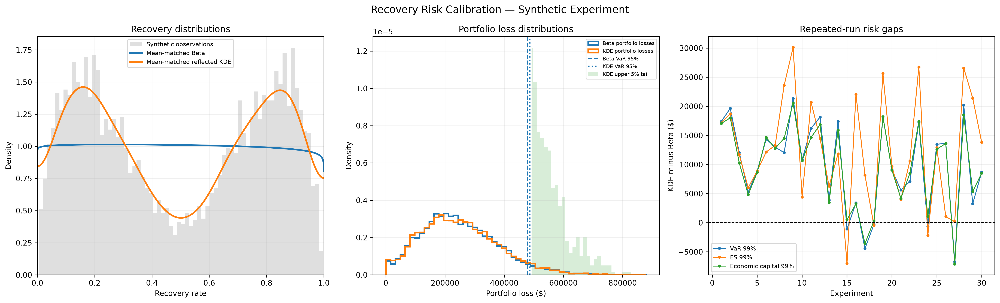

# Recovery Risk Calibration

### Distributional Model Risk in Portfolio Credit-Loss Estimation

## Overview

How much can portfolio credit-risk estimates change when the assumed recovery-rate distribution changes, even when expected recovery is held constant?

This project investigates that question by comparing two recovery-rate models:

- **Parametric Beta distribution**
- **Bounded reflected Kernel Density Estimation (KDE)**

Both distributions are calibrated to the same empirical mean recovery rate. Portfolio losses are then simulated under each model, and differences in Expected Loss, Value at Risk (VaR), Expected Shortfall (ES), and economic capital are evaluated.

**Data disclaimer:** All current experiments use synthetic recovery observations and illustrative portfolio assumptions. Results are not estimates of real-world credit risk.

## Research Question

**How sensitive are portfolio credit-loss estimates to the assumed recovery-rate distribution when expected recovery is held constant?**

The central hypothesis is that matching the expected recovery rate does not necessarily produce matching portfolio tail-risk estimates, because different distributions can have different shapes and tail behaviour.

## Diagnostic Visualization

The following figure summarizes the recovery-density comparison, simulated portfolio losses, and repeated-experiment risk gaps.



*Figure 1. Diagnostic outputs from the synthetic recovery-risk experiment.*

## Methodology

The research pipeline follows these steps:

1. **Generate recovery observations:** Create 5,000 synthetic recovery rates using a bimodal mixture scenario.
2. **Fit recovery distributions:** Fit a Beta distribution and a reflected kernel density estimator.
3. **Calibrate the means:** Apply exponential tilting so both fitted densities match the empirical mean recovery.
4. **Simulate portfolio losses:** Compare the two recovery models using common default outcomes within each experiment.
5. **Calculate risk metrics:** Estimate Expected Loss, VaR, ES, and economic capital at the 95% and 99% confidence levels.
6. **Repeat the experiments:** Run 30 Monte Carlo experiments to examine the variability of the differences between models.
7. **Produce research outputs:** Export diagnostic figures, a research brief, and CSV summaries.

The repeated experiments hold the fitted recovery densities fixed while changing the Monte Carlo random streams. They therefore measure simulation variability conditional on the fitted models, not uncertainty arising from refitting the distributions to new datasets.

## Portfolio Assumptions

| Parameter | Value |
|---|---:|
| Synthetic recovery observations | 5,000 |
| Recovery data-generating scenario | Bimodal mixture |
| Number of obligors | 100 |
| Exposure per obligor | $100,000 |
| Total portfolio exposure | $10,000,000 |
| Default probability per obligor | 5% |
| Simulations per experiment | 10,000 |
| Repeated experiments | 30 |
| Primary experiment seed | 2026 |

These assumptions are illustrative and are not intended to represent an actual lending portfolio.

## Primary Experiment Results

The following table reports the results from the primary portfolio simulation.

| Risk Metric | Beta Model | Reflected KDE | KDE − Beta |
|---|---:|---:|---:|
| Expected Loss | $249,925.29 | $250,257.71 | $332.42 |
| VaR 95% | $478,593.16 | $486,460.00 | $7,866.84 |
| ES 95% | $554,422.25 | $559,092.76 | $4,670.50 |
| Economic Capital 95% | $228,667.87 | $236,202.29 | $7,534.43 |
| VaR 99% | $595,659.36 | $603,072.14 | $7,412.79 |
| ES 99% | $659,112.57 | $667,314.95 | $8,202.38 |
| Economic Capital 99% | $345,734.07 | $352,814.43 | $7,080.37 |

A positive KDE-minus-Beta difference indicates that the reflected KDE produced a higher estimate for that metric in the primary experiment.

Although the two models have the same calibrated mean recovery, their portfolio-risk estimates differ. This illustrates why the assumed recovery distribution can matter when assessing tail risk.

## Repeated-Experiment Analysis

Across 30 repeated Monte Carlo experiments, the estimated differences in 99% risk metrics were:

| Risk Metric | Mean Gap | Standard Deviation | Approx. 95% CI for Mean Gap | Positive Gaps |
|---|---:|---:|---:|---:|
| VaR 99% | $9,901.35 | $7,726.43 | $7,136.49 to $12,666.22 | 25/30 |
| ES 99% | $12,417.68 | $9,507.12 | $9,015.60 to $15,819.76 | 27/30 |
| Economic Capital 99% | $9,776.02 | $7,219.62 | $7,192.51 to $12,359.53 | 28/30 |

The mean 99% economic-capital gap was approximately **$9,776**, with a positive KDE-minus-Beta gap in 28 out of 30 experiments.

The reported confidence intervals use an approximate normal method for the mean gap across repeated experiments. They describe Monte Carlo variability conditional on the fixed fitted densities and modelling assumptions. They are not confidence intervals for real-world portfolio risk or for uncertainty in the fitted recovery distributions.

## Interpretation

The experiment demonstrates that matching expected recovery alone does not guarantee equivalent portfolio-risk estimates.

In this synthetic scenario, the reflected KDE produced higher estimates for all seven risk metrics in the primary experiment. The repeated experiments also showed positive average gaps for the three reported 99% risk measures.

These results are conditional on the selected synthetic data-generating process, estimation methods, portfolio assumptions, and simulation settings. They do not prove that KDE is universally more conservative or more accurate than a Beta distribution.

## Project Structure

```text
recovery-risk-calibration/
├── data/
│   └── historical_recoveries.csv
├── src/
│   ├── __init__.py
│   ├── data_simulator.py
│   ├── density_estimators.py
│   └── risk_metrics.py
├── notebooks/
│   └── recovery_audit_notebook.ipynb
├── reports/
│   ├── diagnostic_plot.png
│   ├── research_brief.md
│   ├── repeated_experiments.csv
│   └── repeated_experiment_summary.csv
├── main.py
├── requirements.txt
└── README.md
```

`data/historical_recoveries.csv` is optional. The current experiment does not depend on historical data, and this file should only contain appropriately sourced observations if real data is added later.

## Installation

### Requirements

- Python 3.10 or later, subject to dependency compatibility
- NumPy
- pandas
- SciPy
- scikit-learn
- Matplotlib
- Jupyter support for running the audit notebook

Install the project dependencies from the project root:

```powershell
python -m pip install -r requirements.txt
```

If you have not created a virtual environment yet:

```powershell
python -m venv .venv
.\.venv\Scripts\Activate.ps1
python -m pip install -r requirements.txt
```

## Run the Research Pipeline

From the project root, activate the environment and run:

```powershell
.\.venv\Scripts\Activate.ps1
python main.py
```

The pipeline generates the following files inside `reports/`:

| Output | Purpose |
|---|---|
| `diagnostic_plot.png` | Visual comparison of recovery densities, portfolio losses, and risk gaps |
| `research_brief.md` | Research question, assumptions, results, interpretation, and limitations |
| `repeated_experiments.csv` | Individual repeated-experiment results |
| `repeated_experiment_summary.csv` | Summary statistics for the repeated risk gaps |

## Run the Research Audit Notebook

Open `notebooks/recovery_audit_notebook.ipynb` in VS Code.

1. Select the Python interpreter from the project's `.venv`.
2. Run the notebook cells sequentially.
3. Inspect the recovery calibration, distribution plot, primary risk comparison, and repeated-experiment results.

The notebook provides an interactive audit of the research outputs and helps verify that the distributions are calibrated to the same mean.

## Limitations

1. **Synthetic observations:** The current recovery sample is simulated rather than sourced from historical loans.
2. **Fixed fitted densities:** Repeated experiments do not refit the recovery distributions.
3. **Homogeneous defaults:** All obligors use the same default probability.
4. **Fixed exposures:** Each obligor has the same exposure.
5. **No default dependence:** Correlation between obligor defaults is not modelled.
6. **No recovery-default dependence:** Recovery rates are not explicitly conditioned on default conditions.
7. **KDE bandwidth sensitivity:** The estimated density depends on bandwidth selection and boundary correction.
8. **Endpoint behaviour:** The continuous distributions do not explicitly model point masses at recovery rates of exactly zero or one.
9. **Approximate confidence intervals:** The reported intervals rely on a normal approximation for repeated-run mean gaps.
10. **Scenario dependence:** Results depend on the selected synthetic scenario, random seeds, and simulation assumptions.

## Reproducibility

The pipeline uses fixed random seeds and configurable simulation parameters to support reproducibility under the same software environment and configuration.

Run `python main.py` to regenerate the primary experiment and its report files. Run the notebook to inspect the calibration and exported results.

## Future Research

Potential extensions include:

- Evaluating the models using appropriately sourced historical recovery data.
- Comparing additional parametric and nonparametric recovery distributions.
- Quantifying model-fitting uncertainty through bootstrap refitting.
- Modelling correlated defaults and dependence between default conditions and recoveries.
- Investigating how recovery-distribution misspecification affects capital estimates under different portfolio compositions.

## Conclusion

This project provides a controlled experiment in **recovery-distribution model risk**. By matching expected recovery across two different distributional models, it isolates how distributional shape can influence simulated portfolio tail-risk measures.

The findings highlight the importance of evaluating more than the mean when selecting recovery models for credit-risk analysis.